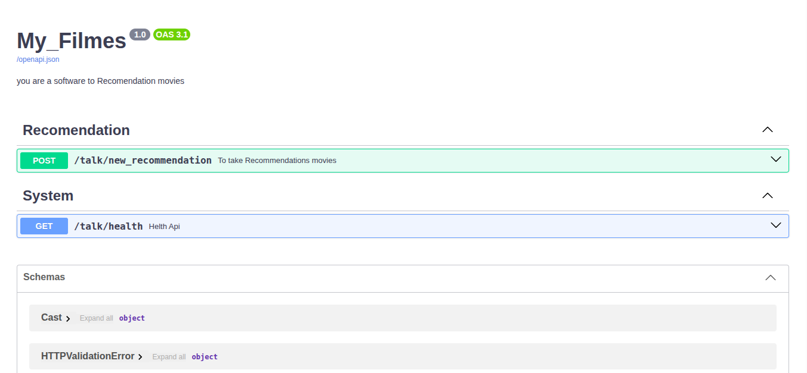
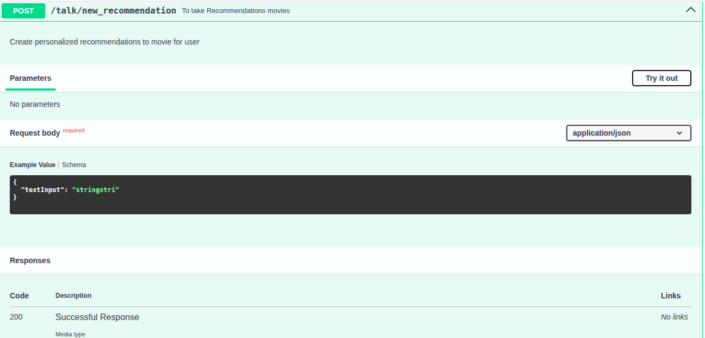
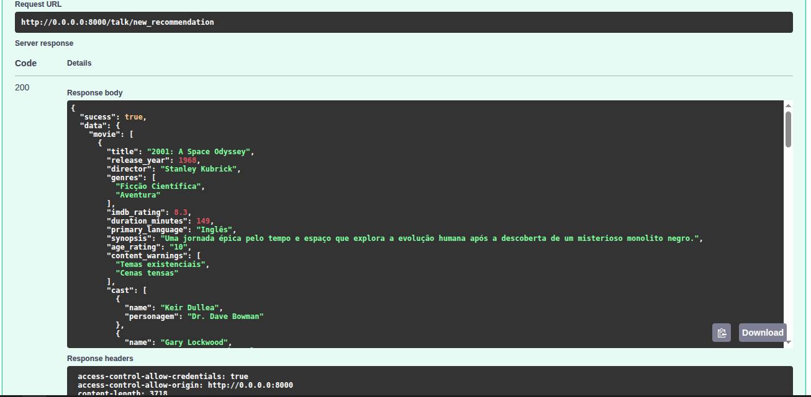

# My Movies - API de Recomendação de Filmes 🎬

*  Um agente inteligente de IA que fornece recomendações personalizadas de filmes via API REST. Utiliza Agno para orquestração de IA, Gemini para análise de preferências, DuckDuckGo para pesquisa web e OMDB API para dados cinematográficos. 


## 🎯 Project:
* My Movies transforma preferências textuais em recomendações estruturadas de filmes, analisando gêneros, atores, rating IMDB, plataformas de streaming, atores, personagens gostos que tenha dito ao agente e oferecendo explicações personalizadas.

## Arquitetura:

* API REST com FastAPI - Endpoints validados com Pydantic
* Agente IA com Agno - Processamento inteligente de preferências
* Integração OMDB - Dados reais de filmes via api
* Pesquisa Web - Informações atualizadas via DuckDuckGo
* Documentação automática - Swagger em /docs e ReDoc em /redoc
* CORS habilitado - Pronto para frontend
* Camada Service e Camada api devidamente estruturadas

# 📦 Arquitetura:
### * Agents:

###### * *Core: configuração do agente e chamada do método para mandar um texto como pergunta para um modelo.*
    
###### * * Prompts: Instruções para o modelo de IA para restringir e ensinar ao modelo como deve-ser feita a resposta *

###### * *tools: Conecção com a api da OMBD*

 ------------------------------------------
### * API:

###### Existe hoje 2 Chamadas de api somente: 

###### 1: *Faz o pedido para o modelo de IA e obtem uma resposta de recomendação de filmes.*

###### 2: *Somente para testar a api e se esta funcionando, para não gastar tokens desnecessariamente.*

##### Camada Http:
###### *FastAPi + Cors + Health*

##### Routes:
###### *Endpoint Post/Recommendations e Get/Health*

----------------------------------------

### Config:

###### * **Somente a configuração do arquivo env e chamadas de variaveis de ambiente com validação dessas chaves.**

----------------------------------------

### Schemas:

###### **Chamados Dtos ou Schemas Pydantic para definição da estrutura do json e objetos python e validação dos dados recebidos.**


__________________________________________

### Service:

###### **Validação e chamada o metodo para iniciar o endpoint de recomendação ao qual manda a pergunta para o modelo de IA.**

----------------------------------------------------------

# 🚀 ⚙️ Começo Rápido:

##### Primeiramente Clone o projeto do git-hub
``` bash
git clone 
```


##### Após clonado o projeto verifique se está instalado o python 3.12, no diretório principal do projeto :
 *my_movies_agent*

##### Inicialize um ambiente vitual com **python3 ou python3.12**: 
 `python3.12 -m venv .venv`

##### Inicie o Ambiente Virtual:
 linux:
 ```bash
 source .venv/bin/activate
 ```
 windows: 
 ```bash
 .venv/Scripts/activate
 ```
### obs: no começo do diretório deve estar: 

#### **(.venv)** 

##### Com a venv habilitada instale os pacotes/bibliotecas que estão no arquivo **requirements.txt**.

```bash
pip install -r requirements.txt
```

## agora criar o arquivo:

## `.env`

a partir do:

## `.env.example`
são 2 chaves api:
* *Chave api google gemini: GEMINI_API_KEY*
* *Chave api do OMBD: OMBD_API_KEY*

E mais uma coisa:
* *modelo de IA do gemini: MODEL_AI_GEMINI*


### Após isso configurado rodar o arquivo main:
##### tem 3 formas para isso:
###### terminal pelo uvicorn:
```python
uvicorn main:app --reload
```
###### terminal pelo python e arquivo main:
```python
python3.12 main.py
```

###### Pelo botão de executar de sua IDE, mas tem que ser executado no arquivo main.py


------------------------------------------------------


# Como Usar:
 ### Após inicar o servidor:
 Ira ter o link:
 ```bash
 http://0.0.0.0:8000 
 ```

 Para acessar o swagger e conseguir mandar requisição http para o modelo de IA com sua pergunta e recomendação de filme.

 ```bash
 http://0.0.0.0:8000/docs
 ```



### A requisição é chamada de new_recomendation:


### Execute e tenha a resposta:


### Datalhes padrão da resposta

```
 POST /recommendations
Content-Type: application/json

{
  "preferences": "Filmes de ação similares ao Tropa de Elite"
}

Response:
{
  "success": true,
  "message": "Recomendações geradas com sucesso",
  "data": {
    "movies": [...],
    "total_recommendations": 5
  }
}
```

# 🔧 Tecnologias
* Framework IA: Agno
* LLM Gemini: gemini-3.1-flash-lite
* API REST: FastApi
* Server: Uvicorn
* Validação: Pydantic
* Buca Web: Web Search(agno)/**duckduckgo**
* Base de dados de filmes: OMBD API
* Variaveis de Ambiente: python-dotenv

📝 Autor: Lucas Gaia Teixeira
* com auxilio do instrutor: **Daniel de Matos Alves** da **Asimov**
